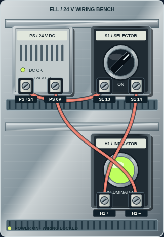
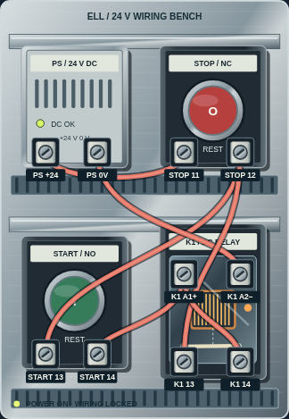
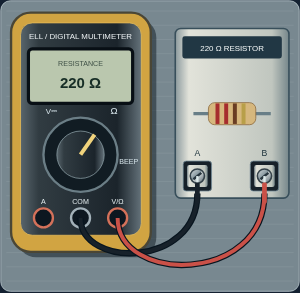

# Virtual wiring labs: 0.5.0-beta.4

Open **Lab → Virtual wiring**. Three original builds teach progressively more complex connections:

| Build | Connections and behavior to prove |
| --- | --- |
| Switched pilot light | Supply, maintained switch, polarized indicator and return; power on with lamp off, switch on, switch off |
| Relay-controlled lamp | Separate coil and contact paths; shared supply with distinct load returns; coil/contact movement controls the indicator |
| Holding circuit | Normally closed STOP in series with a parallel START / auxiliary-contact branch; hold after START release, drop on STOP, no restart on STOP release or restored power |

The panel uses original vector hardware: shaded metal backplate, DIN rails, slotted wire ducts, molded housings, screw terminals, a visible relay winding and moving contact, a selector and illuminated pilot light. Wire curves remain attached to their endpoints as the view resizes. Component identity, terminal purpose and state are also available as text. The existing generated component/coach artwork is retained. No manufacturer product, uploaded print, proprietary drawing geometry or workplace image was used.

Tap a terminal and its destination to fit a wire. Each physical-looking screw has a 48 px interaction target; the optional terminal list offers labeled controls as another input route. Red, blue and black leads are visual choices, not an electrical measurement or universal color convention. Same-terminal taps cancel, duplicate wires are rejected, and the model permits up to three virtual leads per terminal. This teaching limit is not a real terminal rating. Cancel, undo, individual removal and confirmed clearing support repair. A connection plan can be opened for guided practice.

The model computes connectivity from actual wires and closed contacts. A polarized load operates only across positive and return nodes in the defined orientation. The relay coil operates a separate contact without electrically joining coil and contact terminals. Coil state is solved to a stable result, retaining the holding contact only when the wired circuit supports it. Short paths across the supply, including paths created by a closing contact, cut virtual power. The ideal model also cuts power if it cannot settle. Wire editing is locked while powered. Incomplete or bypassed circuits can demonstrate their actual behavior but cannot earn a proved-build badge. The validator accepts equivalent branch connections within the intended nodes, rather than requiring a particular wire order. Full behavior sequences are required after any wiring change.

Click's feedback identifies an actual incorrect terminal pair, a missing connection, a control bypass or a short. Hints adapt to the current wiring: direct supply bridge, coil/contact confusion, holding-path bypass and next missing path each receive relevant guidance. Power state, load state, contact state, next test and full test checklist are visible. Practice is unscored and does not change mission XP.

Wires and earned badges save separately under `ell.wiring.v1`; transient power, held buttons, coil state and test position are never restored. Changing builds turns the outgoing board off; leaving/reopening the lab restores wires with power off. Invalid saved data is preserved without overwriting it. Failed storage does not prevent session practice, and a visible message explains that saving is unavailable. Clearing wires retains an earned badge. Clearing app data/uninstalling removes all local data.

The meter bench now has a shaded instrument with jacks, function selector, fixture, display and attached red/black probe leads. Put each tip on A or B, or lift it. Moving a probe changes the measurement: reversed polarity, same-point zero and a lifted-lead indication are distinct. Existing current-input and powered-resistance guards take precedence; same-point or lifted probes cannot bypass them. The motor lab now shows a contactor, overload and finned motor, with equipment graphics following the existing start/stop/trip/reset model.

These are ideal teaching models, not circuit-design, safety-verification or installation tools. They do not compute fault currents, thermal behavior, wire sizing, protection, motor power or safety integrity. The holding example omits overload and safety-rated functions; those are discussed separately in the course and existing control lab. A power-off indication controls the app only. No real equipment can be connected.

The optional beta study now counts five possible lab visits. Detailed wiring actions, build badges and probe positions are not exported in the study record; observe comprehension and record feedback separately. Earlier known study builds, including 0.4.0-beta.3, remain exportable and paused to avoid combining study versions. Course scores/checkpoints are unchanged. Android versionName is 0.5.0, versionCode 4, with the existing package and dedicated signing certificate.

Validation evidence belongs in `releases/android/beta4-validation.json`; native verification checks the bundled build instructions and probe interface in addition to lesson text, hints, graphics registration, signature and manifest. Browser checks cover all three completed builds, actual terminal clicks, fault diagnosis, tools, saved badges/power-off restore, meter probes and motor equipment states on phone and desktop layouts. No physical-phone validation or new human/synthetic learning outcome is implied.

## App-rendered previews

These phone-layout captures come from the functional browser tests, not physical-device screenshots.

